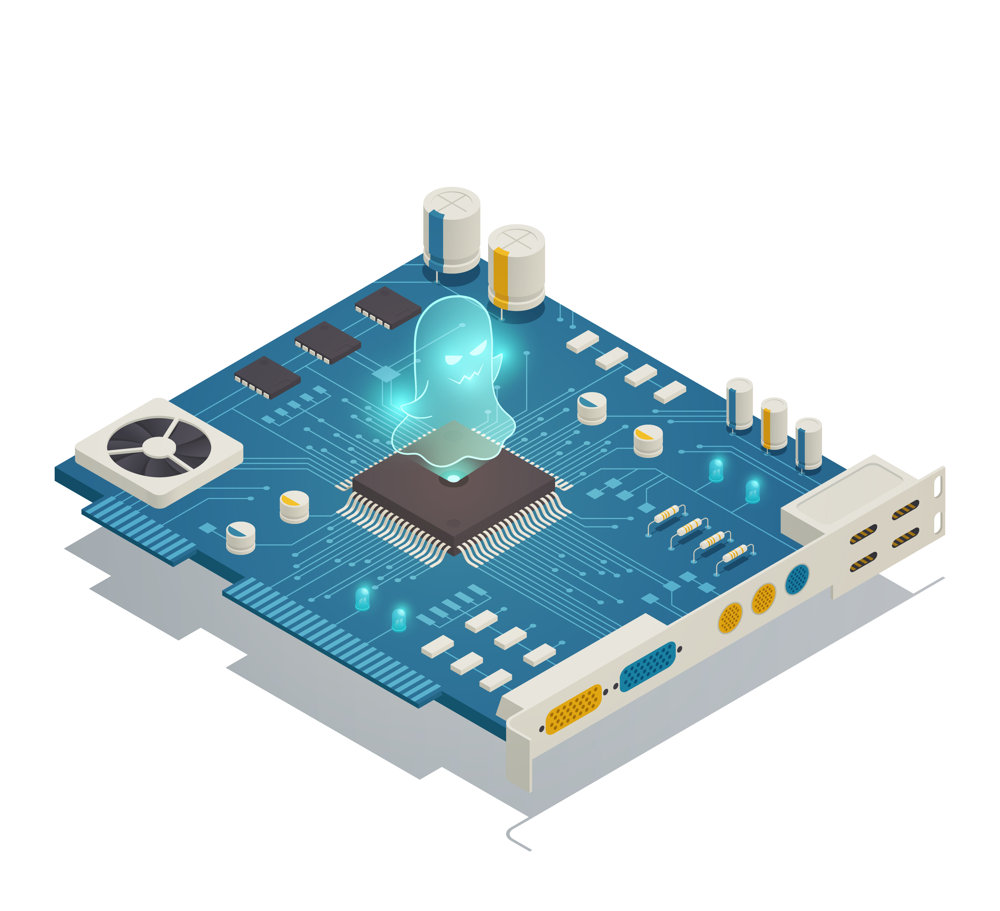

## Overview

This project examines how embedded intelligence can support resilient grid operation and battery energy storage system integration. It connects real-time sensing and control with optimization, analytics, and digital-twin techniques.

<figure class='project-media'><figcaption>Embedded intelligence and control concept</figcaption></figure>

## Research themes

- Battery energy storage system integration
- Embedded optimization and intelligent control
- Real-time grid and IoT analytics
- Digital twins for monitoring and evaluation

The project is under active development.
