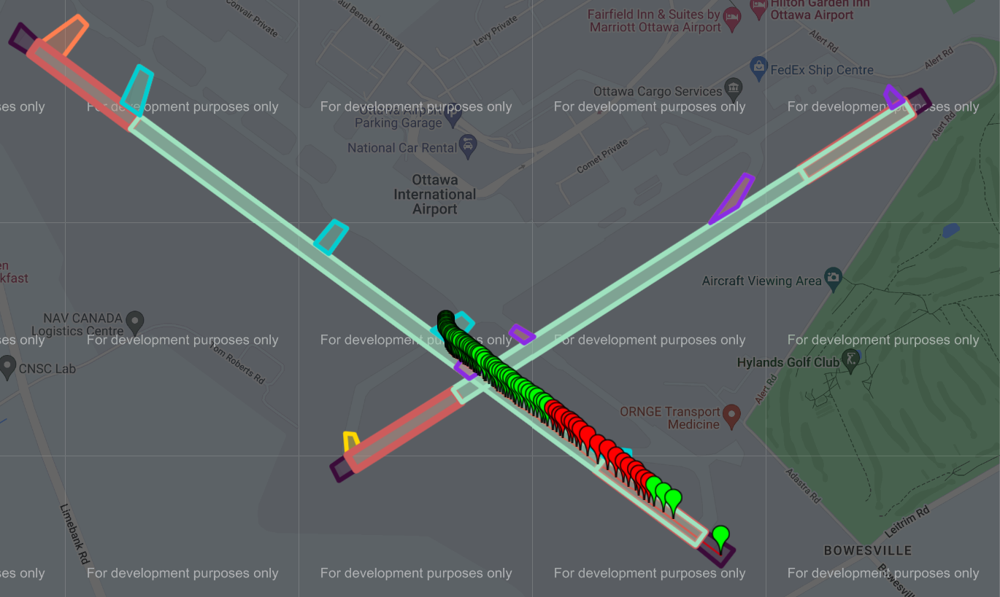
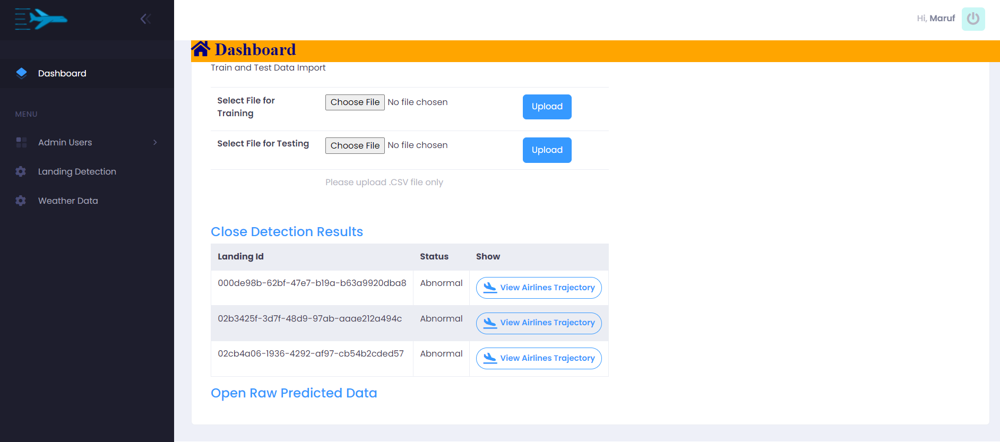

## Overview 🌐
The Aircraft Landing Detection Application is a state-of-the-art system designed to revolutionize air traffic management. It offers a comprehensive suite of tools for monitoring and analyzing aircraft landings and runway statuses, thereby ensuring efficient and safe operations at airports.

  <figure><figcaption>Aircraft trajectory visualization</figcaption></figure>
  <figure><figcaption>Predicted flight path</figcaption></figure>

## How It Works 🧐
The system employs advanced sensors and algorithms to monitor aircraft as they approach the runway. Data collected in real-time is processed to provide instant insights into each aircraft's status and trajectory. These insights are then visualized through an intuitive user interface, allowing air traffic controllers to make informed decisions quickly.

## Main Features 🔥
- **🔐 Secure User Authentication**: Ensures that access is granted only to authorized personnel, maintaining the integrity and security of sensitive operational data.
- **🖥️ Interactive Main Application Interface**: Offers a user-friendly platform for monitoring real-time flight data and airport operations.
- **🛫 Detailed Runway Overview**: Provides real-time status updates for each runway, allowing for efficient traffic management and immediate response to any issues.
- **🔍 Advanced Landing Detection**: Utilizes cutting-edge technology to accurately detect aircraft landings, minimizing the risk of runway incursions and enhancing overall safety.
- **🌐 Comprehensive Airline Trajectory Visualization**: Enables precise tracking of flight paths, aiding in the analysis and optimization of air traffic routes.
- **📈 Predictive Flight Path Analysis**: Employs predictive algorithms to forecast flight paths, allowing for proactive management of air traffic and the prevention of potential conflicts.

<a href="https://github.com/mdalmaruf/AircraftLandingDetection.git" style="color:#52adc8;"><strong>View the project on GitHub </strong></a>
