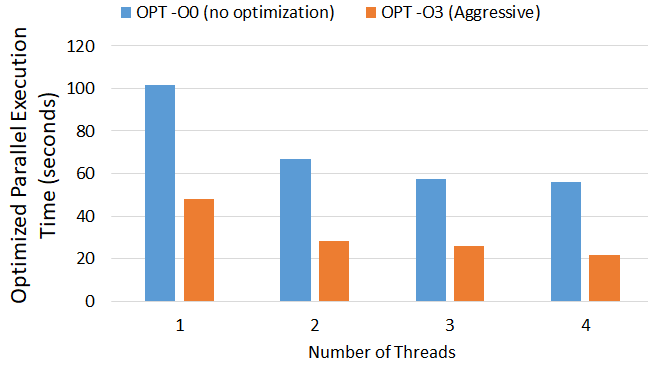

## Overview 🌐
Matrix Multiplication Execution Techniques using OpenMP is a comprehensive project that evaluates the performance of different matrix multiplication methods. By leveraging the power of parallel processing, the project seeks to minimize computational time and enhance efficiency.

<figure class='project-media'>
  
  <figcaption>Optimized parallel-execution performance</figcaption>
</figure>

## How It Works 🧐
The project examines three execution strategies for matrix multiplication—serial, parallel with OpenMP, and optimized parallel—to determine the most effective approach for reducing wall time in computation-heavy tasks.

## Main Techniques 🔥
- **🔢 Serial Execution**: The baseline for performance comparison, running operations in sequence.
- **🚀 Parallel Execution with OpenMP**: Exploits the parallelism offered by OpenMP, distributing tasks across multiple processors.
- **⚙️ Optimized Parallel Execution**: Focuses on compiler optimizations to further reduce computation time.

<a href="https://github.com/mdalmaruf/ParallelComputingOpenMP.git" style="color:#52adc8;"><strong>View the project on GitHub </strong></a>

## Experimental Analysis 📊
The project includes a thorough experimental setup and detailed result analysis to compare the execution times across different methods. The study provides insights into the benefits of parallelization and optimization in computational tasks.

## Findings and Contributions ✨
The findings indicate significant improvements in execution times with parallel and optimized techniques. For a full understanding of the methods and results, the project report is available with detailed graphs and performance analysis.

We welcome contributions and suggestions for further optimizations and enhancements to the project.
